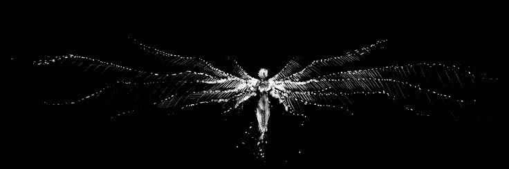

<!-- ===================================================== -->
<!--                 TANISHKA'S GITHUB PROFILE              -->
<!-- ===================================================== -->

<!-- HEADER -->

  

  

<!-- ABOUT ME -->

## About Me

I study Life Sciences at Maitreyi College, University of Delhi. Over time, my interests have been moving more towards the molecular and genetic aspects of biology, along with the computational side of understanding biological systems. I'm particularly interested in how changes in gene expression, molecular interactions and microbial communities can influence disease processes and how hosts respond to different environmental stresses.

What draws me in most is the connection between experimental biology and data analysis. I find public biological datasets especially interesting because they offer an opportunity to explore new research questions, revisit existing findings and investigate biological patterns without necessarily starting from scratch. My interests currently lie somewhere between molecular biology, genetics, genomics, transcriptomics and microbiology, with a growing curiosity about how these areas overlap.

Bioinformatics and computational biology are two areas I'm particularly interested in exploring further and developing practical skills in. I want to understand how a biological question can be translated into a computational approach, how the resulting data can be analysed and interpreted, and how the entire process can be made more reproducible. I also find scientific communication important because research is not just about generating results but also about explaining the methods, reasoning and findings clearly.

I'm still exploring where exactly these interests will take me, but I enjoy learning across disciplines, working with biological data and gradually building the technical and research skills needed to investigate biological questions more independently.

<!-- RESEARCH INTERESTS -->

## Research Interests

---

<!-- PROJECTS -->

## Research & Projects

### 01. From Gene Expression to Protein Networks: C. elegans Response to Pseudomonas aeruginosa Infection

**Independent Research Project | October 2026**

- Reanalysis of publicly available RNA-seq data from NCBI GEO.
- Dataset: GSE121091.
- Explored transcriptional responses associated with Pseudomonas aeruginosa infection in C. elegans.
- Investigated differentially expressed genes and biological response patterns.
- Explored protein–protein interaction networks using STRING.
- Examined potential connections between host response, chemosensory signalling and cellular processes.

🔗 **Repository:** [C. elegans–PA14 Infection Transcriptomics](https://github.com/tanishkaverma9289/C.elegans-PA14-infection-transcriptomics)

<!-- TECH STACK -->

## Tools & Technologies

### Programming & Data Analysis

 

### Bioinformatics & Scientific Tools

### Laboratory Techniques

---

<!-- CURRENTLY LEARNING -->

## Currently Learning

- Python for biological data analysis.
- R programming and statistical analysis.
- RNA-seq data analysis.
- Microbiome data analysis.
- Metagenomics and microbiome analysis.

<!-- CONNECT -->

## Let's Connect

### Until the next discovery...

